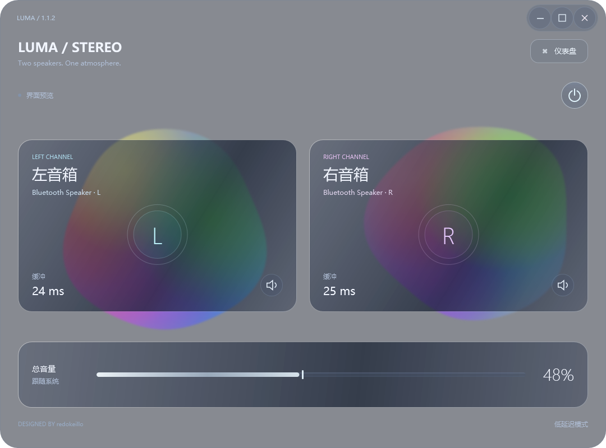

# Luma Stereo

**Two speakers. One atmosphere.**

让你的两个音箱组成立体声

Windows 双音箱立体声路由工具。将一个播放设备的声音分别发送到两只音箱，独立调整声道、相对音量与延迟。



## 下载与使用

从 [Releases](https://github.com/redokeillo/luma-stereo/releases) 下载 Windows x64 便携包，完整解压后运行 `LumaStereo.exe`。

需要 Windows 10/11 x64、.NET Framework 4.8，以及两个可用的播放设备。蓝牙音箱先在 Windows 中完成配对。

1. 推荐安装 [VB-CABLE](https://vb-audio.com/Cable/)，把 Windows 或播放器输出设为 **CABLE Input**。
2. 在仪表盘选择声音来源和左右音箱。来源与两个输出必须是三个不同的设备。
3. 点击电源图标开始播放。总音量默认同步 Windows，两侧音量图标可独立调整相对音量。
4. 使用仪表盘里的校准音确认左右位置，给先响的一侧增加延迟。

详细操作见 [使用说明](docs/USER-GUIDE.zh-CN.md)。VB-CABLE 需单独安装，不包含在发行包中。

## 功能

- 不限定音箱品牌，可选择蓝牙、USB、有线等 Windows 播放设备，只要它能在你的输出设备中显示。
- **低延迟模式**与**稳定模式**，软件缓冲目标分别为 25 ms 和 150 ms。
- 托盘后台播放、可选登录自启与自动播放；托盘中暂停频谱及动画。
- 本地音频处理，不上传音频，不含遥测。

## V1.1.2

- 频谱色块更接近圆形，保留内部多色流动和声音驱动的轻微形变。
- 缓冲竖条跟随屏幕渲染刷新，并平滑过渡。
- 最大化时使用缓存的静态壁纸磨砂层，避免背景退化为纯色。
- 主界面总音量可直接调整系统音量；关闭系统跟随时调整应用音量。

[完整更新说明](docs/CHANGELOG-1.1.2.md)

## 延迟与兼容性

软件缓冲不是端到端延迟。驱动采集块、蓝牙编码与音箱内部缓冲均可能增加延迟；两只音箱没有共享硬件时钟，可能需要重新校准。低延迟模式会按实际数据块大小增加必要余量，不保证始终为 25 ms。硬件兼容性取决于 Windows 驱动、蓝牙适配器和设备同时连接能力。

频谱在 UI 线程约 20 Hz 更新，可在仪表盘关闭。缓冲条的实际刷新率受屏幕与系统负载影响。普通窗口使用系统亚克力；最大化壁纸层使用静态图片，不显示动态壁纸动画或后方应用窗口，也不完全复刻多屏拼接布局。透明效果可单独关闭。

截图使用示例设备和缓冲读数，不代表实测声学延迟。

## 构建

在 Windows x64 PowerShell 中运行：

```powershell
./build.ps1 -Test -Package
```

使用 .NET Framework 自带 C# 编译器，首次从 NuGet 下载固定版本 NAudio 1.10.0 并验证 SHA-256。无需安装 .NET SDK。

- 可执行文件：`bin/Release/LumaStereo.exe`
- 发行包：`dist/LumaStereo-1.1.2-win-x64.zip`
- 更新界面预览：`./build.ps1 -Test -RenderPreview`

自动测试覆盖声道、增益、延迟缓冲、FFT、总音量交互、托盘与窗口状态。硬件兼容性和声学延迟需在实际设备上验证。

## 反馈

提交问题时请附 Windows 版本、音箱型号、蓝牙适配器、所选模式及欠载计数。不用附带个人配置或设备标识。

## 许可

MIT License © 2026 **redokeillo**。NAudio 的 MIT 许可见 [NAudio-LICENSE.txt](NAudio-LICENSE.txt)。VB-CABLE 的使用条件以其官网为准。
